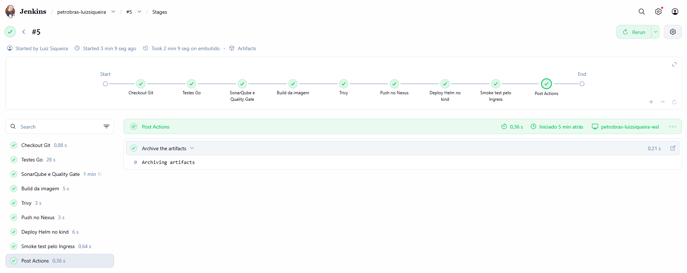
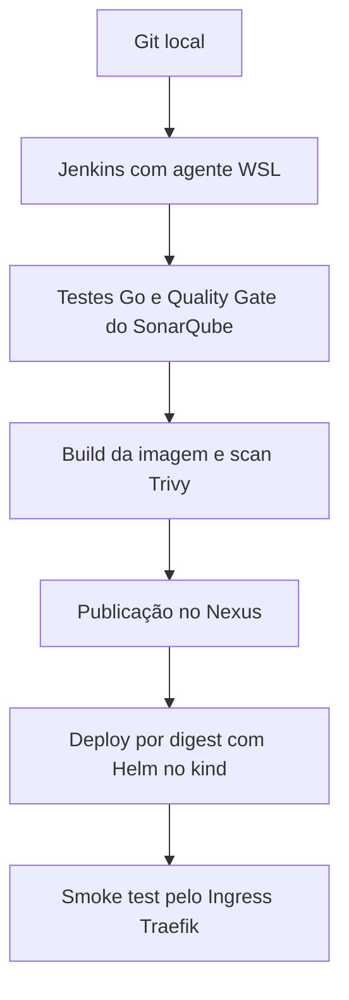

# petrobras-luizsiqueira

POC de entrega de uma aplicação Go em Kubernetes local, com pipeline Jenkins,
controles de qualidade e segurança, observabilidade e rollback com Helm.
A aplicação expõe a versão em `/`, a saúde em `/healthz` e as métricas em `/metrics`.

## Resultados e evidências

- **Entrega:** [Jenkins build #5](evidence/jenkins-pipeline-v0.1.2.png) com testes, Quality Gate, Trivy, push no Nexus, deploy Helm e smoke test pelo Ingress.
- **Qualidade e segurança:** [bloqueio no Jenkins](evidence/jenkins-pipeline-blocked.png), [condição reprovada no SonarQube](evidence/sonarqube-pipeline-blocked.png), [scan da imagem corrigida](evidence/trivy-image-scan-v0.1.1.txt) e [validação do Kyverno](evidence/kyverno-admission-final.txt).
- **Operação no Kubernetes:** [métricas](evidence/grafana-metrics.png), [logs](evidence/grafana-logs.png), [HPA de 1 para 3 réplicas](evidence/hpa-scale-up.md) e [rollback confirmado pelo Ingress](evidence/helm-rollback.txt).



[Índice completo de evidências](evidence/README.md) · [Relatório técnico](docs/relatorio-tecnico.md)

## Arquitetura



O Metrics Server fornece a métrica de CPU para o HPA. O Prometheus coleta
métricas por Pod, e o Promtail envia os logs JSON ao Loki. O Grafana consulta
as duas fontes. O Kyverno valida referências de imagem na criação e
atualização de Pods no namespace da aplicação.

## Pré-requisitos

- WSL2 com Ubuntu, Docker Desktop integrado ao WSL, Docker Compose, Git,
  Python 3, curl, OpenSSL e Java 21 para o agente Jenkins.
- kind `v0.31.0`, kubectl `v1.35.0` e Helm `v4.2.4` em `.local/bin/`.
- Portas locais `5001`, `8081`, `8088`, `18081`, `19000` e `13000` disponíveis.
- Acesso à internet para preparar imagens, charts, plugins e a base do Trivy.
  Os serviços da POC executam localmente.

Use o kubeconfig `.local/kubeconfig` e o contexto `kind-petrobras-luizsiqueira`
para as operações Kubernetes. Mantenha senhas, tokens e kubeconfigs em `.local/`
ou no armazenamento de credenciais do Jenkins.

## Reprodução do ambiente

Siga a ordem abaixo para reproduzir a POC a partir de um clone.

1. **Cluster local.** Na raiz do clone, execute [`./scripts/bootstrap-kind.sh`](scripts/bootstrap-kind.sh). O script usa
   `infra/kind/cluster.yaml`, gera o kubeconfig separado, cria o namespace
   da aplicação e instala Traefik, Metrics Server e Kyverno.
2. **Nexus.** Execute [`./scripts/bootstrap-nexus.sh`](scripts/bootstrap-nexus.sh)
   e abra `http://127.0.0.1:8081`. O script sobe o Compose e configura o
   containerd do kind para usar `http://petrobras-luizsiqueira-nexus:5001`.

   Para localizar a senha inicial do Nexus:

       docker compose -p petrobras-luizsiqueira -f infra/nexus/compose.yaml \
         exec -T nexus cat /nexus-data/admin.password

   Troque a senha inicial e crie um repositório `docker (hosted)` chamado
   `petrobras-luizsiqueira`, usando o conector HTTP `5001` e deixando o acesso
   anônimo desativado. Em **Settings → Realms**, ative **Docker Bearer Token
   Realm**. Crie dois usuários locais ativos com roles limitadas ao repositório.
   Os privilégios começam com `nx-repository-view-docker-petrobras-luizsiqueira-`.

   | Usuário | Privilégios |
   |---|---|
   | `petrobras-luizsiqueira-pull` | `browse`, `read` |
   | `petrobras-luizsiqueira-push` | `browse`, `read`, `add`, `edit` |

   Crie o Secret que o chart usa para fazer pull. O comando solicita a senha
   e exclui o arquivo temporário ao terminar.

       (
         set -euo pipefail
         umask 077
         auth_file="$(mktemp)"
         trap 'rm -f -- "$auth_file"' EXIT

         python3 - "$auth_file" <<'PYTHON'
       import base64
       import getpass
       import json
       import sys

       registry = "petrobras-luizsiqueira-nexus:5001"
       username = "petrobras-luizsiqueira-pull"
       password = getpass.getpass("Senha de pull no Nexus: ")
       if not password:
           raise SystemExit("Informe a senha de pull.")
       auth = base64.b64encode(f"{username}:{password}".encode()).decode()
       with open(sys.argv[1], "w", encoding="utf-8") as output:
           json.dump({"auths": {registry: {"auth": auth}}}, output)
       PYTHON

         k=(.local/bin/kubectl --kubeconfig "$PWD/.local/kubeconfig"
            --context kind-petrobras-luizsiqueira -n petrobras-luizsiqueira)
         "${k[@]}" create secret generic petrobras-luizsiqueira-pull \
           --type=kubernetes.io/dockerconfigjson \
           --from-file=".dockerconfigjson=$auth_file" --dry-run=client -o yaml |
           "${k[@]}" apply --server-side -f -
       )

3. **SonarQube.** Verifique `vm.max_map_count` no kernel usado pelo Docker:

       docker run --rm busybox:1.37.0 cat /proc/sys/vm/max_map_count

   Se o valor for inferior a `524288`, rode `sudo sysctl -w vm.max_map_count=524288`
   no WSL e confira novamente pelo Docker. Se o contêiner ainda mostrar um
   valor inferior, aplique o ajuste no PowerShell com
   `wsl.exe -d docker-desktop -u root -- sysctl -w vm.max_map_count=524288`
   e repita a verificação.

   Gere a senha local do PostgreSQL e suba o Compose:

       (
         set -euo pipefail
         umask 077
         mkdir -p .local
         if [[ ! -s .local/sonarqube.env ]]; then
           printf 'SONAR_DB_PASSWORD=%s\n' "$(openssl rand -hex 24)" > .local/sonarqube.env
         fi
         docker compose -p petrobras-luizsiqueira-sonar \
           --env-file .local/sonarqube.env -f infra/sonarqube/compose.yaml up -d
       )

   Aguarde `status: UP` na API:

       curl --noproxy '*' -fsS http://127.0.0.1:19000/api/system/status

   Abra `http://127.0.0.1:19000`, troque a senha inicial, crie o projeto
   local com chave `petrobras-luizsiqueira` e gere um **Project Analysis Token**.

4. **Jenkins.** Suba o controlador e consulte a senha inicial:

       docker compose -p petrobras-luizsiqueira-jenkins \
         -f infra/jenkins/compose.yaml up -d
       docker compose -p petrobras-luizsiqueira-jenkins \
         -f infra/jenkins/compose.yaml \
         exec -T jenkins cat /var/jenkins_home/secrets/initialAdminPassword

   Abra `http://127.0.0.1:18081`, instale os plugins sugeridos e configure
   zero executores no nó interno do controlador. Cadastre as credenciais:

   | ID | Tipo | Conteúdo |
   |---|---|---|
   | `poc-sonar-token` | Secret text | Token de análise do projeto SonarQube |
   | `poc-nexus-push` | Username with password | Usuário dedicado de publicação do Nexus |

   Crie o agente permanente `petrobras-luizsiqueira-wsl` com um executor,
   rótulo `poc-wsl` e diretório remoto absoluto apontando para
   `.local/jenkins-agent` dentro do clone. Selecione o método em que o agente
   inicia a conexão com o controlador. Na página do nó, copie o valor
   indicado após `-secret`.

   Em um terminal WSL, na raiz do clone, execute o seguinte bloco. O agente
   permanece conectado enquanto esse terminal estiver aberto.

       (
         set -euo pipefail
         umask 077
         agent_dir="$PWD/.local/jenkins-agent"
         mkdir -p "$agent_dir"
         cd "$agent_dir"
         curl --noproxy '*' -fsS -o agent.jar \
           http://127.0.0.1:18081/jnlpJars/agent.jar
         read -r -s -p 'Segredo do agente Jenkins: ' agent_secret
         printf '\n'
         test -n "$agent_secret"
         printf '%s' "$agent_secret" > agent.secret
         unset agent_secret
         java -jar agent.jar -url http://127.0.0.1:18081/ \
           -name petrobras-luizsiqueira-wsl -secret @agent.secret \
           -webSocket -workDir "$agent_dir"
       )

5. **Pipeline.** Crie o job e cole o `Jenkinsfile` em **Pipeline script**.
   Ajuste `POC_ROOT` se o clone estiver em outro caminho no WSL. Execute o
   job. Ele publica a imagem, injeta o digest da publicação no chart e
   valida `/healthz` e `/` pelo Ingress. O primeiro deploy usa a imagem
   que o próprio pipeline publica no Nexus.
6. **Observabilidade.** Execute
   [`./scripts/bootstrap-observability.sh`](scripts/bootstrap-observability.sh).
   O script instala Prometheus, Loki, Promtail e Grafana no namespace
   `observability`, com o dashboard da aplicação e as duas fontes de dados.

Para acessar o Grafana, rode na raiz do repositório e deixe o terminal aberto:

    .local/bin/kubectl --kubeconfig "$PWD/.local/kubeconfig" --context kind-petrobras-luizsiqueira -n observability port-forward --address 127.0.0.1 svc/grafana 13000:80

Abra o [dashboard da aplicação](http://127.0.0.1:13000/d/petrobras-luizsiqueira/).
O usuário inicial é `admin`. A senha está na chave `admin-password`
do Secret `grafana` no namespace `observability`. Gere tráfego na raiz
da aplicação e confira as métricas no dashboard e os logs em
**Grafana Explore → Loki**.

## Validação no ambiente local

Execute a partir da raiz do repositório:

```bash
release=petrobras-luizsiqueira
host="$release.localhost"

.local/bin/kubectl --kubeconfig "$PWD/.local/kubeconfig" \
  --context "kind-$release" -n "$release" \
  get deployment,pods,svc,ingress,hpa

curl --noproxy '*' --resolve "$host:8088:127.0.0.1" \
  --max-time 5 -fsS "http://$host:8088/healthz"

curl --noproxy '*' --resolve "$host:8088:127.0.0.1" \
  --max-time 5 -fsS "http://$host:8088/"
```

O health check deve retornar `ok`. A raiz deve informar a versão implantada.
Para localizar requisições no Loki, use:

```logql
{namespace="petrobras-luizsiqueira", container="app"} | json | msg="request"
```

## Rollback

Consulte o histórico e registre a revisão ativa antes da troca. Escolha uma
revisão cuja imagem tenha sido aprovada pelo Trivy e cujo digest ainda esteja
disponível no Nexus.

```bash
release=petrobras-luizsiqueira
h=(.local/bin/helm --kubeconfig "$PWD/.local/kubeconfig"
   --kube-context "kind-$release" -n "$release")

"${h[@]}" history "$release"
```

Com o número confirmado, execute `helm get values` para conferir a versão e
o digest antes de restaurar. Rode os comandos a seguir no mesmo terminal:

```bash
read -r -p 'Revisão a restaurar: ' revision
if [[ "$revision" =~ ^[1-9][0-9]*$ ]] &&
   "${h[@]}" get values "$release" --revision "$revision" -o yaml; then
  read -r -p 'Digite sim para restaurar a revisão exibida: ' confirm
  if [[ "$confirm" == sim ]]; then
    "${h[@]}" rollback "$release" "$revision" --wait --timeout 3m
  fi
fi
```

Repita a checagem de `/healthz` e `/` para confirmar a saúde e a versão
restaurada. Para retornar à versão mais recente, faça rollback para a revisão
que estava ativa antes do teste. Cada operação cria uma nova revisão Helm.

Na POC, o Ingress confirmou `v0.1.2 → v0.1.1 → v0.1.2`. Houve um HTTP 502
transitório após a primeira troca, seguido de resposta da versão esperada.
O Deployment terminou com uma réplica disponível. [Saída do teste](evidence/helm-rollback.txt)

## Troubleshooting

| Sintoma | O que verificar |
|---|---|
| `ImagePullBackOff` | Eventos do Pod, alias do Nexus na rede `kind`, `hosts.toml` do containerd, Secret de pull e digest no registry. |
| Quality Gate reprovado | Condição e limite no SonarQube. Corrija o código ou os testes e execute novamente. |
| Trivy retorna `10` | O scan encontrou `HIGH` ou `CRITICAL`. Revise o componente afetado, atualize-o e reconstrua a imagem. |
| Helm expira com `Pending termination` | Verifique ReplicaSets, Pods e eventos `FailedDelete`. A política Kyverno deve validar `CREATE` e `UPDATE`. |
| HTTP 502 ou timeout após o deploy | Confira Pods prontos, EndpointSlices e logs do Traefik. Confirme a versão pelo Ingress após a atualização dos endpoints. |
| HPA mostra `<unknown>` | Confira o Metrics Server e se `kubectl top pods` já tem amostras. |
| Grafana trava em `init-chown-data` | Confira os logs do init container. Em um upgrade de `RollingUpdate` para `Recreate`, remova também o campo `rollingUpdate` da estratégia existente. Preserve o PVC. |

## Evidências e relatório

- [Índice de evidências](evidence/README.md)
- [Relatório técnico](docs/relatorio-tecnico.md)
